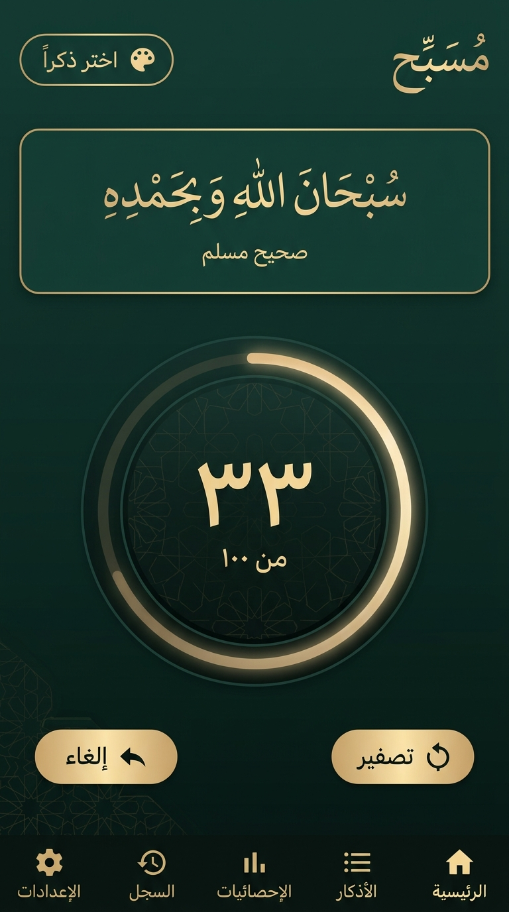
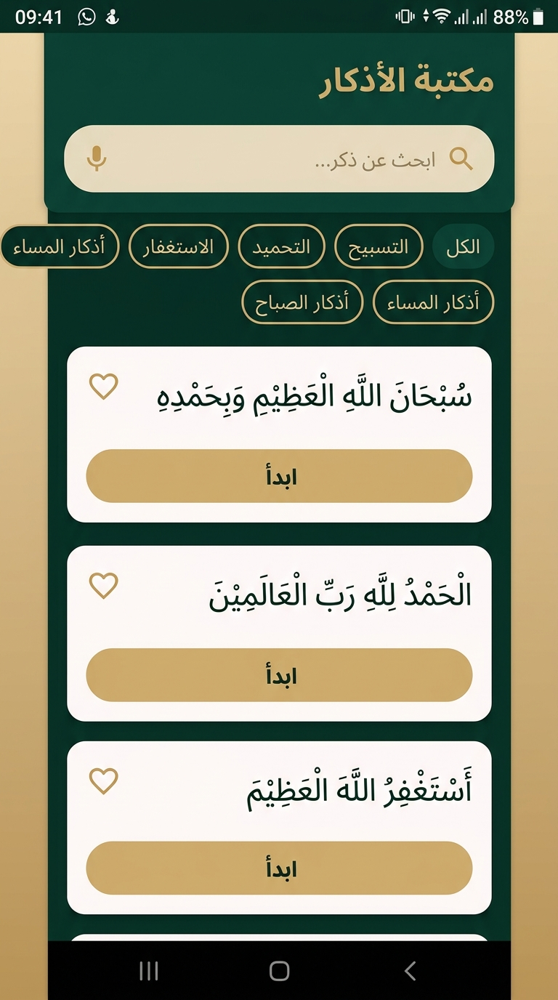
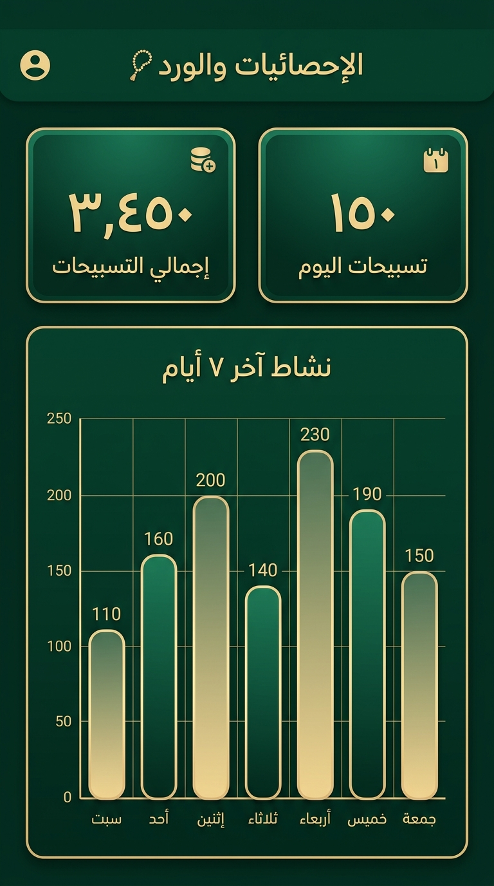

# 📿 Musabbih (مُسَبِّح) — Premium Native Android Tasbeeh, Guided Journey & Prayer Companion

<p align="center">
  
</p>

<p align="center">
  <strong>تطبيق تسبيح وأذكار ومواقيت صلاة إسلامي فاخر، هادئ، ومتقن بنظام أندرويد الأصيل</strong><br>
  <em>A peaceful, offline-first, privacy-respecting native Android Tasbeeh and Prayer Times companion engineered with modern Android architecture.</em>
</p>

<p align="center">
  
  
  
  
  
  
  
</p>

---

## 📦 Direct APK Download

The compiled, verified debug APK is ready in the repository for immediate installation:
- **Project Root Direct File**: `musabbih-debug.apk` (28 MB)
- **Web / Public Folder**: `public/musabbih-debug.apk`
- **Gradle Build Output**: `app/build/outputs/apk/debug/app-debug.apk`

---

## 📸 Screenshots Showcase

<p align="center">
  
  &nbsp;&nbsp;&nbsp;&nbsp;
  
  &nbsp;&nbsp;&nbsp;&nbsp;
  
</p>

<p align="center">
  <em>(1) شاشة التسبيح وبطاقة مواقيت الصلاة والأذان | (2) مكتبة الأذكار ورحلات الأذكار | (3) لوحة الإحصائيات وسلاسل الإنجاز</em>
</p>

---

## ✨ Core Highlights & Philosophy

### 1. 🕌 NEW: Prayer Times & Adhan (مواقيت الصلاة والأذان)
- **Automatic & Manual Location Detection**: Automatic GPS and Network resolution via Google Play Services Location with Geocoder, alongside a comprehensive offline catalog of Algerian wilayas and major Islamic cities.
- **AlAdhan Prayer Times API Integration**: Fetches full monthly timetables using coordinates, caching 30+ days locally into SQLite for uninterrupted offline operation.
- **Algeria Calculation Method 19 Default**: Pre-configured with the official Algerian Ministry of Religious Affairs method (`method = 19`), with selectable international methods (Umm Al-Qura, Muslim World League, Egyptian Authority, ISNA, etc.).
- **Asr Juristic Schools**: Support for both Standard (Shafi'i, Maliki, Hanbali) and Hanafi juristic calculation methods.
- **Home Prayer Card (Compact & Expanded)**:
  - *Compact Mode*: Displays the next prayer, time, live countdown ticker (`متبقي ساعتان و ١٥ دقيقة`), and Adhan status.
  - *Expanded Mode*: Displays all 5 daily prayers plus Sunrise (الشروق), with next prayer highlighted with gold glow.
  - *Unconfigured State*: Shows a polite invitation card allowing users to configure or skip without blocking app usage.
- **Full Daily Timetable Sheet**: Detailed view showing all 6 entries, exact adjusted times, Adhan statuses, and methodology details.
- **Global & Individual Time Adjustments**: Common minute adjustments or separate per-prayer fine-tuning (+/- minutes) for Fajr, Sunrise, Dhuhr, Asr, Maghrib, and Isha.
- **Bundled Algerian Adhan by Sheikh Rabah Ben Drah**:
  - Embedded high-fidelity Algerian Adhan (`R.raw.adhan_rabah`).
  - Master Adhan switch (OFF by default for privacy).
  - Individual per-prayer Adhan switches.
  - Support for personal audio file import (MP3, M4A, WAV) via Android Storage Access Framework (SAF) with preview playback.
  - Configurable playback duration (15s, 30s, 45s, 60s).
- **High-Priority Notification with "إيقاف الأذان" (Stop Action)**:
  - Sticky media foreground notification at prayer time with an immediate **إيقاف الأذان** action to halt playback instantly.
  - Respects Android Silent Mode and Do Not Disturb (DND).
- **Reliable Local Alarm Scheduling**:
  - Scheduled locally on the device using `AlarmManager` with a rolling 7-day window.
  - Rebuilt automatically on device reboot (`BOOT_COMPLETED`), date/time adjustments (`TIME_SET`, `TIME_CHANGED`), and timezone changes (`TIMEZONE_CHANGED`).
  - Graceful fallback when exact alarm permissions are restricted by battery optimization.

---

### 2. 🌟 Guided Dhikr Journey (رحلة الأذكار)
- **Sequential Spiritual Completion**: Guided traversal through canonical Adhkar collections:
  - **أذكار الصباح (Morning Adhkar)**: Canonical Hadith texts with verified targets (e.g., Ayat al-Kursi, Al-Mu'awwidhat 3x, Sayyid al-Istighfar, Subhanallahi wa bihamdihi 100x).
  - **أذكار المساء (Evening Adhkar)**: Sunset and night protection supplications in their authentic prophetic sequences.
  - **أذكار بعد الصلاة (After Prayer)**: Sunnah Adhkar following fard prayers (Istighfar 3x, Ayat al-Kursi, Tasbeeh 33x, Tahmeed 33x, Takbeer 33x, La ilaha illallah 1x).
  - **أذكار النوم (Sleep Adhkar)** & general curated collections.
- **Pre-Journey Overview Sheet**: Displays collection details, item count, verified repetition targets, and past progress with **ابدأ الرحلة** or **متابعة الرحلة**.
- **Unobtrusive Header & Progress**: Displays the current position (e.g., `الذكر ٣ من ١٢`), overall journey progress bar, and collection title directly above the counter dial.
- **Intentional Completion Flow (Never Auto-Advances)**: When a Dhikr reaches its target, the screen presents 3 clear options:
  1. **الذكر التالي (Next Dhikr)**: Shows a preview dialog with text and repetition count before proceeding.
  2. **إعادة الذكر (Repeat Dhikr)**: Resets the item count to 0 to repeat the Dhikr with full devotion.
  3. **إنهاء الرحلة (Finish Journey)**: Saves partial progress to Room and returns smoothly.
- **Celebratory Completion Screen**: Dedicated closing screen (*ما شاء الله - أتممت رحلة أذكار الصباح*) with total repetitions, duration, and restart/return actions.

---

### 3. 📿 Robust Counter Engine
- **Atomic Database Transactions**: Every tap and undo executes inside a Room SQLite transaction protected by a mutex-serialized processor to guarantee zero lost taps even during rapid tapping.
- **Target Crossing & Continuity**: Reaching a target triggers subtle milestone haptics and visual badges without halting or resetting the flow.
- **Transactional Undo & Safe Reset**: Undo restores the previous count and reverses daily tallies. Reset requires explicit user confirmation.
- **Session Durability**: Unfinished sessions automatically survive process death, screen rotation, and device restarts.

---

### 4. 📖 Authentic Dhikr Library
- **13 Verified Categories**: All built-in entries carry exact citations from Sahih al-Bukhari, Sahih Muslim, Sunan Abi Dawud, and Quranic Surah & Ayah with `REVIEWED` status.
- **Diacritic-Insensitive Search**: Normalizes Arabic diacritics for instant search while preserving authentic Quranic typography.
- **Custom Adhkar**: Add, edit, and delete personal Adhkar with custom repetition targets.

---

### 5. 📊 Accurate Statistics & Date Boundary Handling
- **Across-Midnight Attribution**: Uses `session_daily_totals` to record repetitions per local date and timezone, correctly attributing counts when sessions cross midnight boundaries.
- **Insightful Metrics**: Today’s repetitions, all-time totals, consecutive day streaks, longest streak, and top 5 most-used Adhkar.
- **Weekly Activity Chart**: 7-day activity bar chart with localized Arabic weekday indicators.

---

### 6. 🔒 Privacy-First & 100% Offline
- **Zero Tracking**: 100% local SQLite database with zero analytics, ads, or external telemetry.
- **User-Controlled JSON Backup & Restore**: Export and import full app state using the Android Storage Access Framework (SAF).

---

### 7. 🎨 Luxury Islamic Design System
- **Emerald & Champagne Gold Palette**: Inspired by Islamic architecture with deep forest green surfaces (`#111811`, `#1B241D`, `#263128`) and subtle champagne gold accents (`#D5C29B`).
- **RTL-First**: Designed natively from the ground up for right-to-left Arabic typography and layouts.
- **Bundled Fonts**: Locally bundled **Noto Naskh Arabic** for authentic Quranic/Hadith typography and **Noto Sans Arabic** for navigation and controls.
- **Adaptive Icons**: Custom adaptive vector launcher icons matching the deep emerald mihrab arch and gold prayer beads.

---

## 🛠️ Tech Stack & Architecture

- **Language**: Kotlin 2.2+ (100%)
- **UI Framework**: Jetpack Compose (BOM 2024.09.00)
- **Design System**: Material Design 3 (M3) with Dark / Light / System theme support
- **Architecture**: Clean Architecture + MVVM + Single-Source-of-Truth Engine
- **Persistence**: Room 2.7.0 (Schema v3 with non-destructive migrations `MIGRATION_1_2` and `MIGRATION_2_3`) + DataStore Preferences
- **Networking**: Retrofit 2.12.0 + Moshi Kotlin 1.15.2 (AlAdhan API client with offline caching)
- **Location**: Google Play Services Location 21.3.0
- **Audio & Media**: Android MediaPlayer with AudioFocusRequest & Foreground Media Service
- **Scheduling**: Android AlarmManager (Exact & Inexact alarms) + BroadcastReceivers + WorkManager 2.9
- **Testing**: JUnit 4, Robolectric 4.16+, AndroidX Test

```
com.example/
├── core/
│   ├── backup/        # JSON export/import & validation logic
│   ├── database/      # Room entities, DAOs, Database v3 & seed data
│   │   ├── dao/       # CategoryDao, CounterDao, DhikrDao, JourneyDao, PrayerDao
│   │   └── entity/    # DhikrEntity, PrayerTimeEntity, DhikrJourneyEntity...
│   ├── datastore/     # Preferences repository (theme, numerals, haptics)
│   ├── engine/        # Atomic CounterEngine & JourneyEngine
│   ├── reminder/      # WorkManager reminder worker & scheduler
│   └── ui/            # Arabic number formatters & text normalizers
├── feature/
│   ├── home/          # Interactive counter dial & PrayerTimesHomeCard
│   ├── prayer/        # Complete Prayer Times & Adhan Feature
│   │   ├── data/      # AlAdhan API service, location helper & repositories
│   │   ├── domain/    # PrayerModels, calculation methods & offset math
│   │   ├── audio/     # AdhanAudioManager, notification & AdhanPlaybackService
│   │   ├── scheduling/# PrayerAlarmScheduler, AlarmReceiver & BootReceiver
│   │   └── presentation/ # Home card, Timetable dialog, Quick setup & Settings
│   ├── journey/       # Guided Dhikr Journey components & completion screen
│   ├── adhkar/        # Library browsing, category filters & Start Journey CTAs
│   ├── statistics/    # Streak analytics, summary cards & weekly chart
│   ├── history/       # Session archives & Journey history detail dialogs
│   └── settings/      # Theming, Prayer settings section, backup/restore & privacy
├── navigation/        # Bottom navigation bar & type-safe routes
├── ui/theme/          # M3 color tokens, Noto typography & RTL theme wrapper
├── MainActivity.kt    # Single activity entry point with edge-to-edge
└── MusabbihApplication.kt
```

---

## 🚀 Building & Running the Project

### Prerequisites
- Android Studio Hedgehog or newer
- JDK 17+
- Android SDK 36 (Minimum SDK: 26 / Android 8.0)

### Build Commands
```bash
# Build the Debug APK
gradle assembleDebug

# Run Unit & Robolectric Tests
gradle :app:testDebugUnitTest
```

The compiled APK is available at:
- `musabbih-debug.apk` (Project root)
- `public/musabbih-debug.apk` (Public asset folder)
- `app/build/outputs/apk/debug/app-debug.apk` (Standard Gradle output)

---

## 📄 License & Privacy
- **Privacy**: Musabbih collects **0** bytes of user information and makes no network requests other than querying the open AlAdhan prayer schedule for your chosen city/coordinates.
- **Religious Content**: Built-in Adhkar are verified from canonical Hadith collections and the Holy Quran. Default Adhan is recited by Sheikh Rabah Ben Drah (الشيخ رابح بن دراح الجزائري).
